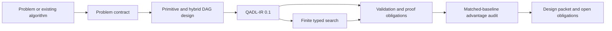

<p align="center">
  
</p>

# Quantum Algorithm Designer

An evidence-gated Codex plugin for agent-guided design, formalization, search, verification, and audit of quantum and hybrid algorithms.

[简体中文](README.zh-CN.md)

> **Research prototype (0.1.x).** This project generates and ranks machine-readable algorithm candidates. It does not automatically prove correctness, derive asymptotic complexity, or certify quantum advantage.

## Why this project exists

Quantum algorithm design is not the same task as writing a gate-level SDK demo. A defensible design must preserve the problem promise, access model, output contract, classical baseline, hybrid control flow, resource model, and open proof obligations. Quantum Algorithm Designer keeps those objects explicit and makes them available to Codex as eight coordinated skills plus deterministic CLI and MCP tools.

The project is built around four principles:

1. **Contracts before circuits.** Freeze what is being solved and how inputs and outputs are accessed before selecting a primitive.
2. **Theorem preconditions before analogy.** Reject a quantum primitive when its mathematical assumptions do not hold.
3. **Search scores are not proofs.** Random, evolutionary, Pareto, and reinforcement-learning results remain candidate-generation evidence.
4. **Advantage claims fail closed.** Unknown costs, unmatched baselines, or missing proof artifacts block stronger claims.

## Workflow



The loop is deliberately reversible. A failed proof obligation or audit returns the candidate to the earliest invalid assumption instead of polishing an unsupported claim.

## Included skills

| Skill | Responsibility |
| --- | --- |
| `orchestrate-quantum-algorithm-design` | Runs the gated end-to-end loop and routes failures back to the earliest invalid assumption. |
| `frame-quantum-problem` | Freezes distributions, promises, access, I/O costs, output quality, and matched classical baselines. |
| `select-quantum-primitives` | Selects or rejects primitives from their theorem preconditions, not keyword similarity. |
| `design-hybrid-quantum-workflow` | Builds a classical/quantum/I/O DAG and charges boundary, measurement, communication, mitigation, and decoding costs. |
| `formalize-quantum-algorithm` | Emits QADL-IR 0.1 and reviewable proof obligations, then routes supported obligations to external backends. |
| `search-quantum-algorithm-space` | Runs reproducible random/evolutionary Pareto search and optional PPO/MaskablePPO exploration. |
| `verify-quantum-algorithm` | Applies an evidence ladder from schema/tests through external machine proofs and resource evidence. |
| `audit-quantum-advantage` | Gates claims on matched access, output, accuracy, success probability, resources, and classical baselines. |

## What it can and cannot establish

| Output | Establishes | Does not establish |
| --- | --- | --- |
| `validate` returns `valid: true` | Full JSON Schema validation and implemented cross-field consistency checks passed. | Semantic correctness or truth of proof artifacts. |
| `analyze` returns numeric values | Declared resource expressions evaluated at supplied parameter points. | An asymptotic bound or scaling theorem. |
| `formalize` returns a document | A reviewable problem interface, stage contracts, and proof-obligation scaffold. | A machine-checked proof. |
| `export-qmd` creates a handoff | QADL obligations are protected qmd-prover goals with stable provenance and an explicit imported-contract assumption. | Lean/Coq-style formal verification or automatic QADL status promotion. |
| Search returns a Pareto archive | Candidates are feasible and nondominated under the declared evaluator. | Correctness, novelty, generalization, or advantage. |
| `audit` has no blockers | The implemented evidence gates passed. | Automatic certification or a peer-reviewed scientific conclusion. |

See [Scientific claim policy](docs/SCIENTIFIC_CLAIMS.md) for the complete rules.

## Quick start

Requirements: Python 3.10 or newer.

```bash
git clone https://github.com/DebinXiangQuantum/QuantumAlgoAgents.git
cd QuantumAlgoAgents
python3 -m venv .venv
source .venv/bin/activate
python3 -m pip install -r scripts/requirements-core.txt
```

Run the bundled Grover search contract through the deterministic tools:

```bash
python3 scripts/qad_cli.py validate \
  assets/examples/grover-oracle-search.qadl.json

python3 scripts/qad_cli.py analyze \
  assets/examples/grover-oracle-search.qadl.json \
  --points assets/examples/resource-points.json \
  --out resource-samples.json

python3 scripts/qad_cli.py formalize \
  assets/examples/grover-oracle-search.qadl.json \
  --out formal-contract.md

python3 scripts/qad_cli.py audit \
  assets/examples/grover-oracle-search.qadl.json \
  --out advantage-audit.json
```

The example contains a conditional query-level claim. Passing its audit does not convert the oracle assumption into an end-to-end speedup.

### Optional qmd-prover handoff

Install `qmd-prover` and Pandoc separately, initialize a dedicated proof project, and export the QADL obligations:

```bash
mkdir qmd-handoff
cd qmd-handoff
qmd-prover init
cd ..

python3 scripts/qad_cli.py export-qmd \
  assets/examples/grover-oracle-search.qadl.json \
  --project qmd-handoff

cd qmd-handoff
qmd-prover inspect project
```

Without an explicit `--proofs` JSON sidecar, every exported obligation remains `open`. A sidecar proof must cite `{{qadl-contract}}` where it uses the imported candidate contract. qmd-prover can then apply mechanical graph checks and an optional independent AI verifier. Any accepted result remains conditional on the reported assumption footprint and is not a formal proof certificate.

### Search a finite design space

```bash
python3 scripts/qad_cli.py search \
  assets/examples/grover-resource-tradeoff.search.json \
  --method random --budget 64 --seed 11 \
  --out random-seed-11.search-result.json

python3 scripts/qad_cli.py search \
  assets/examples/grover-resource-tradeoff.search.json \
  --method evolutionary --budget 64 --population-size 16 --seed 11 \
  --out evolutionary-seed-11.search-result.json
```

The effective budget is capped by the finite Cartesian search-space size. The bundled example has only two combinations, so both commands evaluate at most two unique candidates.

### Optional reinforcement learning

```bash
python3 -m pip install -r scripts/requirements-search.txt
python3 scripts/train_sb3.py \
  assets/examples/grover-resource-tradeoff.search.json \
  --algorithm maskable-ppo --steps 5000 --seed 11 \
  --model-out qadl-ppo --candidate-out qadl-ppo-best.json
```

`--candidate-out` contains the complete best evaluation record; the QADL object is nested under its `candidate` field. The current action mask prevents no-op assignments but does not encode every syntax or semantic precondition. A policy score is never a correctness or advantage certificate.

### CLI exit codes

| Command | Success | Validation/audit failure | Input or execution error |
| --- | --- | --- | --- |
| `validate` | `0` | `1` | `2` |
| `analyze` | `0` | `1` for evaluation errors | `2` |
| `audit` | `0` when no blockers remain | `2` | `2` |
| `formalize`, `export-qmd`, `search` | `0` | Not applicable | `2` |

An `audit` exit code of `0` means only that the implemented gates passed.

## MCP interface

The plugin registers an SDK-free stdio server through `.mcp.json`. Full validation still requires `jsonschema`; validation fails closed when it is unavailable.

The server exposes six tools:

- `qadl_validate_candidate`
- `qadl_analyze_resources`
- `qadl_audit_advantage`
- `qadl_render_formal_contract`
- `qadl_render_qmd_handoff`
- `qadl_search_candidates`

Both formal renderers return `machine_checked: false`. The qmd handoff renderer is pure and returns source plus provenance; the CLI writes it into a project already initialized by qmd-prover. MCP search accepts random or evolutionary search, caps a requested budget at 500, and then caps it again at the finite search-space size. Optional PPO training is a separate script, not an MCP tool.

The canonical source repository is [DebinXiangQuantum/QuantumAlgoAgents](https://github.com/DebinXiangQuantum/QuantumAlgoAgents). Public Codex marketplace distribution is a separate release channel; cloning the repository is sufficient for the CLI, schemas, examples, and development workflow documented here.

## QADL-IR 0.1

QADL-IR is a project-local typed exchange contract above circuit IRs. It preserves:

- the problem distribution, promises, access model, I/O and oracle costs;
- classical baselines with contract-equivalent outputs;
- a stage DAG spanning classical, quantum, measurement, control, and I/O work;
- declared resource expressions and error budgets;
- correctness, resource, and advantage proof obligations;
- claim scope, evidence state, and provenance.

It is not a theorem prover, a quantum semantics, or a substitute for Qbricks, SQIR/VOQC, qRHL, Qualtran, OpenQASM, or QIR. Backend lowering is an explicit trust boundary until the translation itself is verified. See [QADL-IR contract](docs/QADL_IR.md).

## Architecture

The deterministic core lives in `scripts/qadlib/`; learning is optional and cannot modify the evidence gates. See [Architecture](docs/ARCHITECTURE.md) for module boundaries, invariants, and external trust assumptions.

```text
.codex-plugin/plugin.json      Codex plugin manifest
.mcp.json                      stdio MCP registration
skills/                        Eight evidence-gated workflows
assets/schemas/                QADL and search-space JSON Schemas
assets/examples/               Executable contract/search examples
assets/brand/                  Editable marks and rendered plugin icons
scripts/qadlib/                Deterministic validation/search/audit core
scripts/qadlib/qmd.py          qmd-prover proof-obligation handoff
scripts/qad_cli.py             Command-line interface
scripts/mcp_server.py          MCP server
scripts/train_sb3.py           Optional PPO/MaskablePPO search
tests/                         Contract, audit, search, MCP, and packaging tests
```

## Development

Install the core dependency and run:

```bash
python3 -m unittest discover -s tests -v
```

The repository CI runs the core suite across supported Python versions and a small optional-RL smoke test. Scientific or resource claims require primary sources, explicit assumptions, and evidence artifacts; simulator output alone is insufficient.

Read [CONTRIBUTING.md](CONTRIBUTING.md) before submitting a change. Security reports must follow [SECURITY.md](SECURITY.md), and community participation is governed by [CODE_OF_CONDUCT.md](CODE_OF_CONDUCT.md).

## Project governance and support

- [Governance](GOVERNANCE.md)
- [Support](SUPPORT.md)
- [Changelog](CHANGELOG.md)
- [Citation metadata](CITATION.cff)

The project does not currently promise support or review service-level agreements.

## License

Licensed under the [Apache License 2.0](LICENSE). The Contributor Covenant-derived code of conduct carries its own attribution and CC BY-SA 4.0 terms as stated in that file.
