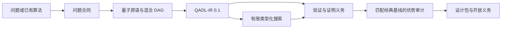

<p align="center">
  
</p>

# Quantum Algorithm Designer

一个采用证据门控机制的 Codex 插件，用于智能体辅助的量子与量子-经典混合算法设计、形式化、搜索、验证和优势审计。

[English](README.md)

> **研究原型（0.1.x）。** 本项目生成并排序机器可读的算法候选，但不会自动证明正确性、推导渐近复杂度或认证量子优势。

## 为什么需要这个项目

量子算法设计不等于编写门级 SDK 示例。一个可辩护的设计必须同时保留问题承诺、访问模型、输出合同、经典基线、混合控制流、资源模型和未关闭的证明义务。Quantum Algorithm Designer 将这些对象显式化，并通过八个相互协作的 Codex skills、确定性 CLI 和 MCP 工具进行操作。

项目遵循四条原则：

1. **先定义合同，再写线路。** 在选择量子原语前冻结问题、输入访问和输出等价条件。
2. **先检查定理前提，再做类比。** 数学前提不成立时必须拒绝相应量子原语。
3. **搜索分数不是证明。** 随机、进化、Pareto 和强化学习结果只提供候选生成证据。
4. **优势声明采用 fail-closed。** 隐藏成本、基线不匹配或证明工件缺失都会阻断更强声明。

## 工作流



该流程允许回退：证明义务或优势审计失败时，候选会返回到最早失效的假设，而不是继续润色不受支持的结论。

## 八个内置 skills

| Skill | 职责 |
| --- | --- |
| `orchestrate-quantum-algorithm-design` | 串联端到端门控流程，并把失败定位到最早失效假设。 |
| `frame-quantum-problem` | 冻结分布、规模参数、承诺、访问、I/O 成本、输出质量和匹配经典基线。 |
| `select-quantum-primitives` | 依据定理前提选择或拒绝原语，而不是按关键词相似度拼接。 |
| `design-hybrid-quantum-workflow` | 构建经典/量子/I/O DAG，并计入边界、测量、通信、缓解和解码成本。 |
| `formalize-quantum-algorithm` | 输出 QADL-IR 0.1 和可审查证明义务，再将支持的义务路由到外部后端。 |
| `search-quantum-algorithm-space` | 执行可复现的随机/进化 Pareto 搜索及可选 PPO/MaskablePPO 探索。 |
| `verify-quantum-algorithm` | 按 schema/tests、外部机器证明和资源证据组成的证据阶梯核验候选。 |
| `audit-quantum-advantage` | 对访问、输出、精度、成功率、资源和经典基线进行最终声明门控。 |

## 工具结论的边界

| 输出 | 能说明什么 | 不能说明什么 |
| --- | --- | --- |
| `validate` 返回 `valid: true` | 完整 JSON Schema 与已实现的跨字段一致性检查通过。 | 语义正确性或证明工件内容为真。 |
| `analyze` 返回数值 | 在指定参数点求值声明的资源表达式。 | 渐近界或扩展性定理。 |
| `formalize` 返回文档 | 生成可审查的问题接口、阶段合同和证明义务框架。 | 机器检查证明。 |
| 搜索返回 Pareto 档案 | 在声明的评估器下候选可行且非支配。 | 正确性、新颖性、泛化或优势。 |
| `audit` 没有 blocker | 已实现的证据门通过。 | 自动认证或同行评审结论。 |

完整规则见[科学声明政策](docs/SCIENTIFIC_CLAIMS.md)。

## 快速开始

要求 Python 3.10 或更高版本。

```bash
git clone https://github.com/DebinXiangQuantum/QuantumAlgoAgents.git
cd QuantumAlgoAgents
python3 -m venv .venv
source .venv/bin/activate
python3 -m pip install -r scripts/requirements-core.txt
```

对内置 Grover 搜索合同运行确定性工具：

```bash
python3 scripts/qad_cli.py validate \
  assets/examples/grover-oracle-search.qadl.json

python3 scripts/qad_cli.py analyze \
  assets/examples/grover-oracle-search.qadl.json \
  --points assets/examples/resource-points.json \
  --out resource-samples.json

python3 scripts/qad_cli.py formalize \
  assets/examples/grover-oracle-search.qadl.json \
  --out formal-contract.md

python3 scripts/qad_cli.py audit \
  assets/examples/grover-oracle-search.qadl.json \
  --out advantage-audit.json
```

示例中的结论是有条件的查询级声明。审计通过并不会把 oracle 假设转换成端到端加速。

### 搜索有限设计空间

```bash
python3 scripts/qad_cli.py search \
  assets/examples/grover-resource-tradeoff.search.json \
  --method random --budget 64 --seed 11 \
  --out random-seed-11.search-result.json

python3 scripts/qad_cli.py search \
  assets/examples/grover-resource-tradeoff.search.json \
  --method evolutionary --budget 64 --population-size 16 --seed 11 \
  --out evolutionary-seed-11.search-result.json
```

实际预算不会超过有限笛卡尔空间的大小。内置示例只有两个组合，因此两个命令最多各评估两个唯一候选。

### 可选强化学习

```bash
python3 -m pip install -r scripts/requirements-search.txt
python3 scripts/train_sb3.py \
  assets/examples/grover-resource-tradeoff.search.json \
  --algorithm maskable-ppo --steps 5000 --seed 11 \
  --model-out qadl-ppo --candidate-out qadl-ppo-best.json
```

`--candidate-out` 保存完整的最佳评估记录，QADL 对象位于其中的 `candidate` 字段。当前 action mask 只阻止 no-op 赋值，并不编码全部语法和语义前置条件。策略分数永远不是正确性或优势证书。

### CLI 退出码

| 命令 | 成功 | 验证/审计失败 | 输入或执行错误 |
| --- | --- | --- | --- |
| `validate` | `0` | `1` | `2` |
| `analyze` | `0` | 存在求值错误时为 `1` | `2` |
| `audit` | 无 blocker 时为 `0` | `2` | `2` |
| `formalize`、`search` | `0` | 不适用 | `2` |

`audit` 返回 `0` 仅表示已实现的门控条件通过。

## MCP 接口

插件通过 `.mcp.json` 注册不依赖 MCP SDK 的 stdio 服务。完整验证仍然依赖 `jsonschema`，该依赖缺失时验证会 fail-closed。

服务暴露五个工具：

- `qadl_validate_candidate`
- `qadl_analyze_resources`
- `qadl_audit_advantage`
- `qadl_render_formal_contract`
- `qadl_search_candidates`

形式化渲染器始终返回 `machine_checked: false`。MCP 搜索只支持 random/evolutionary，请求预算上限为 500，随后还会被有限空间大小进一步限制。PPO 训练是独立脚本，不属于 MCP 工具。

规范源码仓库为 [DebinXiangQuantum/QuantumAlgoAgents](https://github.com/DebinXiangQuantum/QuantumAlgoAgents)。公开 Codex marketplace 属于独立发布渠道；克隆该仓库即可使用这里记录的 CLI、schema、示例和开发流程。

## QADL-IR 0.1

QADL-IR 是位于线路 IR 之上的项目本地类型化交换合同，保留：

- 问题分布、承诺、访问模型以及 I/O、oracle 成本；
- 输出合同等价的经典基线；
- 覆盖经典、量子、测量、控制和 I/O 的阶段 DAG；
- 资源表达式与误差预算；
- 正确性、资源和优势证明义务；
- 声明范围、证据状态和 provenance。

它不是定理证明器、量子语义，也不替代 Qbricks、SQIR/VOQC、qRHL、Qualtran、OpenQASM 或 QIR。后端 lowering 在转换本身得到验证前属于显式信任边界。详见 [QADL-IR 合同](docs/QADL_IR.md)。

## 架构与目录

确定性核心位于 `scripts/qadlib/`；学习模块是可选的，不能修改证据门控。模块边界和信任假设见[架构文档](docs/ARCHITECTURE.md)。

```text
.codex-plugin/plugin.json      Codex 插件清单
.mcp.json                      stdio MCP 注册
skills/                        八个证据门控工作流
assets/schemas/                QADL 与搜索空间 JSON Schema
assets/examples/               可执行合同与搜索示例
assets/brand/                  可编辑图标源文件与插件图标
scripts/qadlib/                确定性验证、搜索与审计核心
scripts/qad_cli.py             命令行接口
scripts/mcp_server.py          MCP 服务
scripts/train_sb3.py           可选 PPO/MaskablePPO 搜索
tests/                         合同、审计、搜索、MCP 与打包测试
```

## 开发与开源治理

安装核心依赖后运行：

```bash
python3 -m unittest discover -s tests -v
```

CI 会覆盖多个受支持 Python 版本，并执行一次小型可选 RL smoke test。任何科学或资源声明都必须给出一手来源、显式假设和证据工件；模拟器输出本身不充分。

提交修改前请阅读[贡献指南](CONTRIBUTING.md)。安全问题按[安全政策](SECURITY.md)私密报告，社区参与遵循[行为准则](CODE_OF_CONDUCT.md)。其他入口：

- [治理](GOVERNANCE.md)
- [支持](SUPPORT.md)
- [变更日志](CHANGELOG.md)
- [引用信息](CITATION.cff)

项目目前不承诺支持或审查的服务等级协议。

## 许可证

项目采用 [Apache License 2.0](LICENSE)。由 Contributor Covenant 改编的行为准则按该文件所列的 CC BY-SA 4.0 条款和署名使用。
