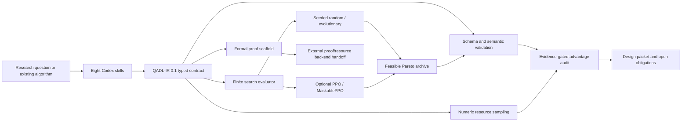

# Architecture

Quantum Algorithm Designer separates candidate generation from deterministic validation and scientific claim review. This prevents a search policy from becoming its own judge.

## System view

## Layers

### Interaction layer

The eight directories under `skills/` define the reasoning workflow exposed to Codex. They frame a problem, select primitives, design a hybrid DAG, formalize QADL, search, verify, audit, and orchestrate the full loop. Skills may propose candidates but cannot override deterministic evidence gates.

### Contract layer

`assets/schemas/qadl.schema.json` and `assets/schemas/search-space.schema.json` define versioned data contracts. Examples are executable fixtures, not normative proofs. QADL stays above circuit IRs so access, I/O, hybrid work, baselines, resources, claims, and proof obligations survive lowering.

### Deterministic core

`scripts/qadlib/` contains:

- `expressions.py`: a restricted numeric AST evaluator over declared parameters;
- `validation.py`: JSON Schema and cross-field validation;
- `audit.py`: resource sampling and advantage-claim gates;
- `formal.py`: a reviewable Z-style and quantum Hoare proof scaffold;
- `search.py`: finite genome materialization, deterministic evaluation, and Pareto archiving;
- `environment.py`: an optional Gymnasium environment over the same evaluator.

The core does not execute generated source code and does not import arbitrary candidate expressions.

### Search layer

Random and evolutionary search are deterministic under a fixed search space, evaluator, and seed. The optional PPO and MaskablePPO path changes proposal behavior only; it does not change validation, resource accounting, or claim gates. A Pareto archive records nondominance under declared metrics rather than collapsing scientific validity into one reward.

### Interface layer

`scripts/qad_cli.py` exposes validation, numeric analysis, formal rendering, audit, and random/evolutionary search. `scripts/mcp_server.py` exposes the same deterministic operations through stdio JSON-RPC without an MCP SDK dependency. Full schema validation requires `jsonschema` and fails closed when it is unavailable.

### External backend boundary

Qbricks/Why3, SQIR/VOQC, qRHL, Qualtran, OpenQASM, QIR, hardware compilers, and resource estimators are handoff targets, not embedded trust anchors. A translation into any backend is trusted until either:

1. the translation is independently reviewed, or
2. a semantics-preservation argument or machine-checked translation is supplied.

An external artifact may close a proof obligation only when the obligation identifies that artifact and its review status is explicit.

## Core invariants

- QADL and search-space versions are explicit.
- Stage identifiers are unique and dependency graphs are acyclic.
- Every dependency names an existing stage.
- Every quantum stage names a primitive.
- Resource expressions use only declared variables and the approved arithmetic AST subset.
- An obligation marked `proved` or `formally-verified` names at least one artifact.
- A speedup claim selects a declared classical baseline.
- Quantum and classical comparisons match access model and output contract.
- Unknown costs are never silently converted to zero.
- Higher-fidelity claims require higher-fidelity resource models.
- No automated path returns an advantage certificate.

## Data flow and failure behavior

1. A skill or user supplies a candidate or finite typed search space.
2. Schema and cross-field validation run before a candidate is treated as feasible.
3. Resource expressions are sampled only at explicit parameter points.
4. Search records validation errors, claim blockers, warnings, resources, and closed obligations as separate metrics.
5. The claim auditor compares access, output, quality, cost scope, resource model, proof obligations, and evidence.
6. Any blocker yields `blocked-insufficient-evidence`; the candidate returns to design with the blocker preserved.

Dependency absence, malformed input, and unsupported claims fail closed. A warning may preserve a candidate for research, but it cannot be promoted into proof evidence.

## Reproducibility contract

A search result is reproducible only with the exact:

- plugin and QADL/search-space versions;
- base candidate and choices;
- evaluation parameter points, metrics, and hard constraints;
- search method, budget, population size, and seed;
- Python and optional learning-library versions.

For learned policies, also retain the serialized model, training steps, algorithm, and best evaluation record. Reproducibility of a search trajectory does not imply scientific generalization.

## Security boundary

Candidate expressions are data, not Python programs. The evaluator accepts a deliberately small numeric expression language. The MCP server uses structured JSON-RPC errors and caps search budgets. Generated algorithms, external proof artifacts, compilers, simulators, and remote hardware remain untrusted inputs until reviewed under the policies in `SECURITY.md` and `docs/SCIENTIFIC_CLAIMS.md`.
